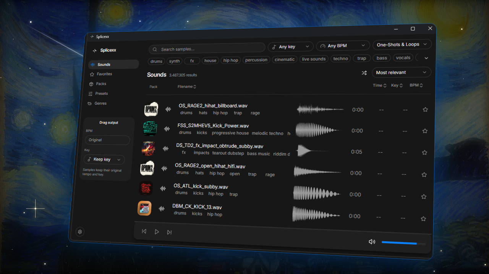

<p align="center">
  
</p>

<h1 align="center">Splicexx</h1>

<p align="center">
  A fast, account-free desktop sample browser for <a href="https://splice.com">Splice</a>.<br>
  Search, preview and drag samples straight into your DAW, with BPM and key changed on the fly.
</p>

<p align="center">
  Built with <a href="https://svelte.dev">Svelte 5</a>, <a href="https://tauri.app">Tauri 2</a> and Rust.
</p>

---

## Features

- **No account needed.** Search Splice's sample library directly from the app.
- **Drag & drop into your DAW.** Samples are written to your samples folder as WAV.
- **Change BPM and key when you drag.** Set a target tempo and key in the sidebar and every sample you drag out is time-stretched and pitch-shifted to match, with the new values in its filename.
- **Favorites** stored locally, one click from any result.
- **Packs, presets and genres** to browse, with pack-level filtering.
- **Waveform previews** and a compact player with volume control.
- **Filters and sorting**: key, BPM, one-shots or loops, tags, shuffle and relevance, popularity or recency.

## Getting started

### Prerequisites

- [Node.js](https://nodejs.org) (LTS) and [pnpm](https://pnpm.io/installation)
- [Rust](https://rustup.rs)
- The [Tauri prerequisites](https://v2.tauri.app/start/prerequisites/) for your OS

### Run in development

```bash
pnpm install
pnpm tauri dev
```

### Build a release

```bash
pnpm tauri build
```

Developed and tested on Windows 11.

## How it works

Splice's search endpoint only accepts requests that come from its own website. Splicexx opens a hidden webview on splice.com and relays search requests to it over Tauri events, so the results come back the same way they would on the site. Previews are fetched and descrambled in the app, and dragging a sample writes a WAV file that your DAW can import.

BPM and key changes use [SoundTouchJS](https://github.com/cutterbl/SoundTouchJS). They run in a Web Worker so the interface stays responsive, and each processed file is cached by its target values.

## Credits

- Based on [splicerr](https://github.com/robert-k/splicerr) by Robert-K (MIT), the Svelte and Tauri frontend this project grew from.
- Inspired by [splicedd](https://github.com/ascpixi/splicedd) by ascpixi.
- Showcase background: *The Starry Night* by Vincent van Gogh (1889), public domain, from [Wikimedia Commons](https://commons.wikimedia.org/wiki/File:Van_Gogh_-_Starry_Night_2.jpg).
- Made by Ultraaa30.

## Disclaimer

Splicexx is an unofficial project and is not affiliated with or endorsed by Splice. Samples belong to their creators, and Splice's terms of service apply to everything you download. Use it responsibly.
